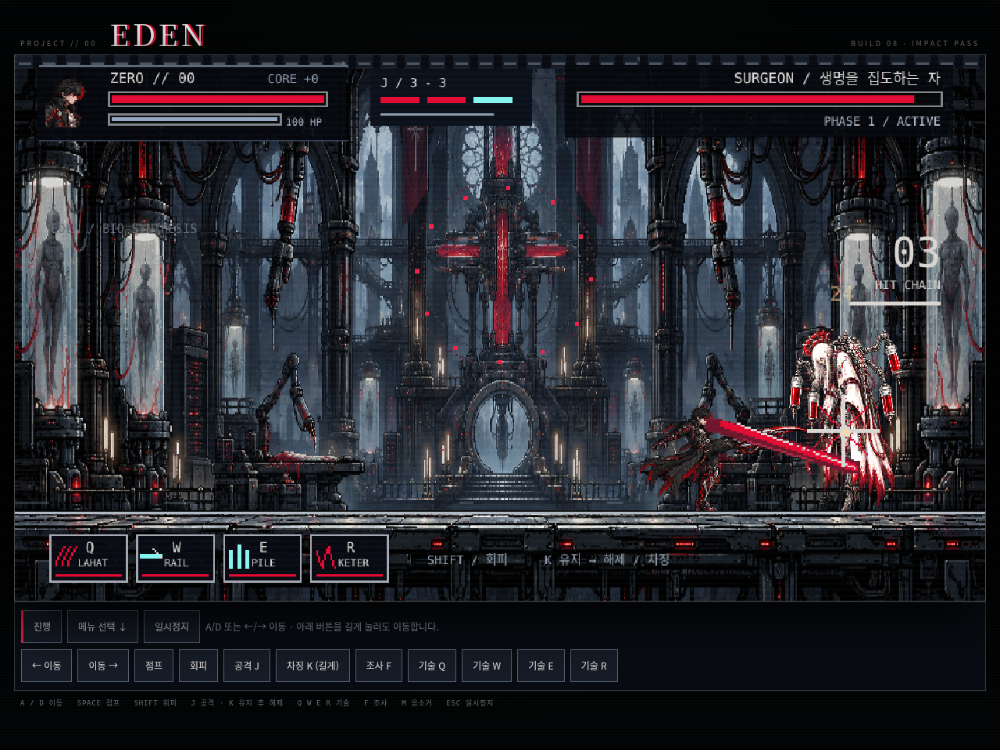
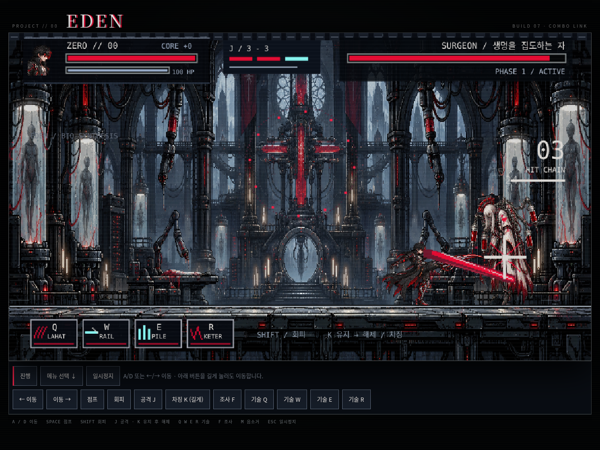
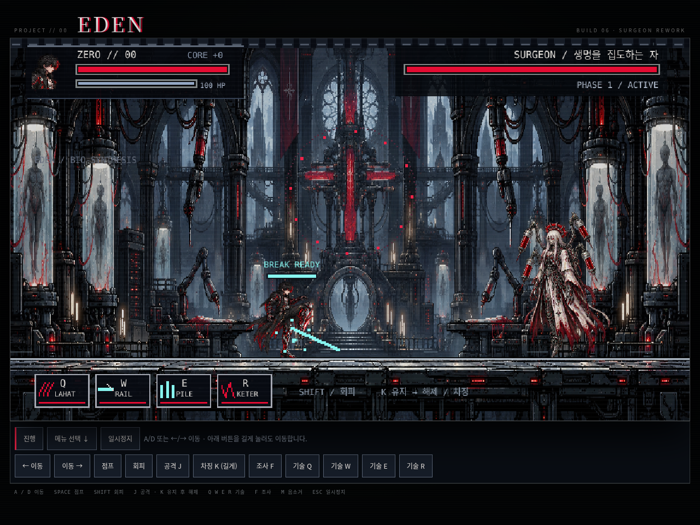
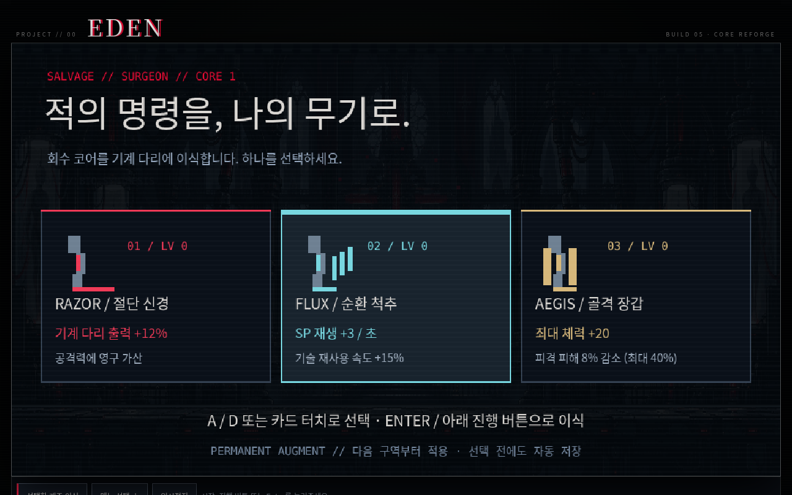
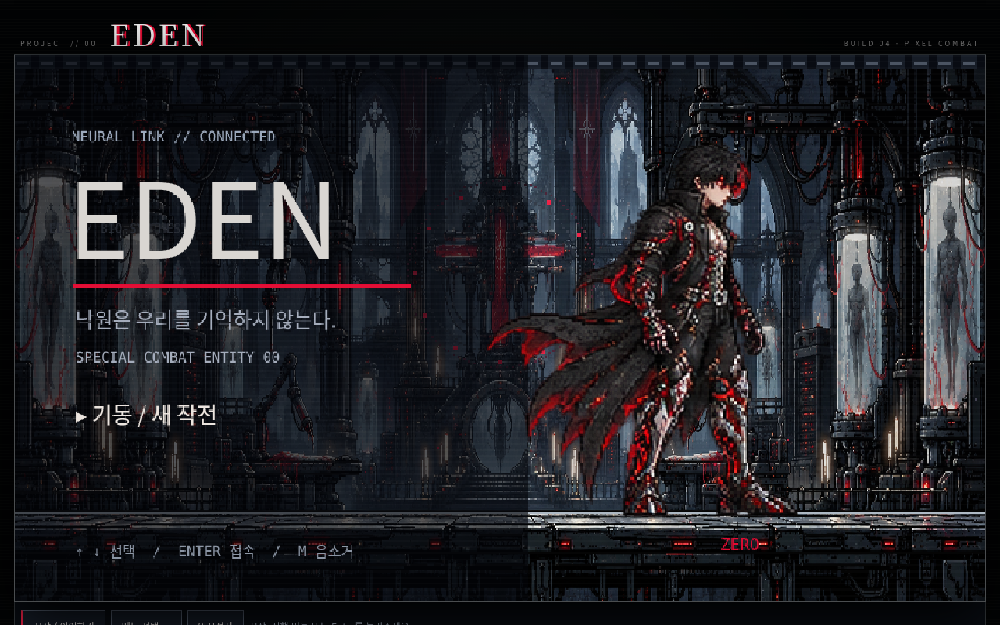

# EDEN — BUILD 10 / SUTURE DUEL

화면 오른쪽 위 **BUILD 10 · SUTURE DUEL**로 버전을 확인하세요.

ZERO는 기계 다리를 펼쳐 차고 찍는 근접 전투원, SURGEON은 수술 장치로 거리를 통제하는 보스입니다. J의 덧붙인 도형 다리를 제거하고 새 전신 공격 시트와 보스의 낮은 절개 자세를 생성·적용했습니다. 준비 → 타격 → 회수 자세를 재생하며, 일부 동작은 기존 프레임을 재사용합니다.

SURGEON은 거리에 따라 접근·후퇴하고 절개·낙하·바늘 견제를 선택합니다. 공격 방향은 예고 때 고정되고, 공격 후 반격할 시간이 생깁니다. K로 시전을 끊은 직후에는 4초간 연속 시전 중단이 제한됩니다. 실제 온라인 PvP는 아닙니다.

J/K 적중 → Q → Q 마지막 타격 적중 → R 연결은 유지합니다. Q의 세 타격을 자세 변화에 맞췄고, J와 R의 판정을 실제 다리 범위에 맞게 줄였습니다. E는 지상에서 전방 한 곳에 말뚝을 박으며 SP 24 / 재사용 3초입니다. K 최대 충전은 0.65초입니다.

[ZERO 공격 프레임](docs/previews/zero-duel-frames.png) · [SURGEON 공격 프레임](docs/previews/surgeon-duel-frames.png)

## 이전 타격 피드백 개선

이번 버전은 기존 전투의 타격 피드백을 다듬었습니다. 명중 순간에만 강도별 충격음·짧은 섬광·방향성 반동이 나오고, HUD는 흔들리지 않습니다. 타격 정지는 22/42/65ms로 구분하고 카메라 반응은 최대 1.8 게임 픽셀로 제한했습니다. 피해량·사거리·공격 시간·적 패턴·SP 비용은 유지했습니다.

타격 정지 중 점프 입력, 피격 시 공중 상태와 자세, 재시작 시 잔여 효과를 수정했습니다. 궁극기 배너는 짧게 표시하고 입자량을 줄였습니다. [진단·우선순위·두 차례 조정 내역](docs/COMBAT_AUDIT.md)을 확인할 수 있습니다.



이번 점검에서는 공격 동작 끝나기 직전의 입력을 0.22초간 한 번 예약하도록 개선했습니다. 타격 정지 중 입력도 보존하며, 피격·회피·일시정지 시 공격 예약은 취소됩니다. J는 짧은 절단 → 올려 베기 → 긴 마무리로 연결되고, 상단에 3연타 단계가 표시됩니다. 키를 계속 누르는 것만으로 자동 연타되지는 않습니다. 기술은 앞선 동작이 끝난 뒤 연결되며 동시에 동작을 덮어쓰지 않습니다.

Q 삼연 절단이 짧은 피격 무적 때문에 두 번만 맞던 문제도 수정했습니다. 30fps·60fps에서 모두 세 타격을 확인했습니다. 명중 위치에는 강도에 따른 짧은 섬광을 추가했습니다.



## 이번 전투 변경

- **K 유지 → 해제**: 짧게 누르기 / 0.4초 충전 / 0.65초 최대 충전으로 피해와 사거리가 달라집니다. 최대 충전의 `BREAK READY`를 보고 놓으세요. 화면의 K 버튼도 길게 눌렀다 놓습니다.
- **회피 우선**: 충전 중 이동 가능. Shift·피격·일시정지·창 전환은 충전을 취소합니다. 주인공 표시 크기와 몸통 피격 영역을 줄였고 이동 속도와 회피 거리를 늘렸습니다. 망토와 무기 끝에는 피해를 받지 않습니다.
- **SURGEON 공방**: 위치가 고정되는 세 줄 낙하, 방향이 고정되는 주사기 산개, 점프로 넘을 수 있는 낮은 절개. 붉은 예고를 보고 피한 뒤 `EXPOSED` 때 반격하면 피해가 25% 증가합니다. 최대 차징을 시전 중 적중시키면 시전을 끊고 긴 빈틈을 만듭니다. 미리 충전하고 접근하는 전략도 가능합니다.
- **구분되는 기술 효과**: Q 삼연 칼날, W 청록색 레일 궤적, E 금속 말뚝, R 압착 단두각. 주사기는 약통과 바늘을 표시합니다. 충전 단계 음향과 강타의 타격 정지 효과도 추가했습니다.
- **잡몹 회피**: 드론의 사격 방향을 점선으로 예고하고 예고 후에는 플레이어를 다시 추적하지 않습니다.



[첫 보스의 공격 전조](docs/previews/surgeon-warning.png) · [레일포 효과](docs/previews/rail.png) · [지면 말뚝 효과](docs/previews/pile.png)

이번 버전은 첫 보스와 공통 조작·효과를 중심으로 수정했습니다. 다른 6보스의 패턴 전체를 재설계한 버전은 아닙니다. 아래 코어 개조와 기존 저장 기능은 유지됩니다.

보스를 해체하면 **절단 출력 / 에너지 순환 / 골격 장갑** 중 하나를 영구 개조합니다. A/D 또는 카드 터치로 선택한 뒤 Enter나 **선택한 개조 이식** 버튼을 누르세요. 선택 전 종료해도 보상을 이어서 받을 수 있습니다. 처치 연출에 전투 시간과 최고 연속 타격이 표시되며, 전투 중 2.4초 안에 다음 타격을 연결하면 연속 타격 계기가 유지됩니다. 피격 시 초기화됩니다. 구역별 비·재·발광 입자도 추가했습니다.



이번 버전은 ZERO의 대기·달리기·다리 칼날 공격·다리 레일포를 이미지 프레임으로 재생합니다. SURGEON의 준비·공격·피격 자세, 수술 성당 배경과 HUD를 교체했습니다. 손에 든 검은 제거했습니다.



[실제 렌더러로 확인한 ZERO의 동작 프레임 보기](docs/previews/zero-animation.png)

한국어 HTML5 Canvas 보스 액션 게임의 개발 버전입니다. 외부 패키지나 API 키 없이 실행됩니다.

## 게임 보기

GitHub에서 **Code → Download ZIP → 압축 풀기 → index.html 열기**. `index.html`, `styles.css`, `src` 폴더를 함께 유지하세요. 키보드가 있는 데스크톱 브라우저용입니다.

브라우저가 파일 실행을 제한한다면 압축을 푼 폴더에서 다음 명령을 실행하세요.

```bash
python3 -m http.server 4173
```

브라우저에서 `http://localhost:4173`을 여세요. 진행 상황은 브라우저의 `localStorage`에 보관됩니다.

Windows에서는 `python3` 대신 `python` 또는 `py`를 사용할 수 있습니다.

## 조작

- `A` / `D`: 이동
- `←` / `→`: 이동 (한글 입력 상태에서도 물리 키로 처리)
- `Space`: 점프
- `Shift`: 회피
- `J`: 기본 공격 / `K`: 누르고 충전, 놓으면 공격
- `Q` / `W` / `E` / `R`: 전투 기술
- `Esc`: 일시정지
- `F`: 단말 조사 / 보스 구역 접속
- `M`: 음소거
- 메뉴: 방향키 또는 `W` / `S`, `Enter`

화면 아래의 **시작 / 대사 다음** 버튼으로 진행할 수 있습니다. **← 이동 / 이동 →** 버튼을 마우스나 터치로 길게 누르면 이동합니다. 통신 화면에서는 대사를 넘긴 뒤 이동할 수 있고, 다른 창으로 전환해 일시정지됐다면 **계속하기**를 누르세요.

## 첫 작전

통신을 Enter로 읽은 뒤 D로 전진하세요. 첫 회랑의 단말은 F로 조사할 수 있습니다. 다음 격실에서 드론 두 대를 제거하면 문이 열립니다. 마지막 격실 오른쪽 문 앞에서 F를 누르면 보스전에 진입합니다. 재정비 때 체력이 회복되며 보스 앞 체크포인트가 저장됩니다.

Q: LAHAT 삼연 절단 / W: RAIL 관통탄 / E: PILE 전방 말뚝 / R: KETER 압착 단두각.
일반 공격 적중으로 SP를 회복합니다. 코어 회수당 공격력이 8%, 최대 체력이 5 증가합니다.
WARDEN의 정면 장갑에는 K 강 공격으로 과부하를 누적하세요.

## 현재 범위

7보스 기본 전투·2페이즈, 고유 장비와 공격, 기록 조사·보안 드론·재정비 구간, 대사, 코어 강화, 체크포인트, 재도전, 엔딩 기록을 구현했습니다. 관절형 캐릭터와 구역별 배경, 회피 잔상, 타격 정지, 위험 지대, 합성 금속음과 산업적 음악을 사용합니다.

**목표인 4시간 분량은 아직 아닙니다.** 새 이미지 에셋의 주 적용 범위는 ZERO, SURGEON, 수술 성당입니다. 나머지 여섯 보스는 관절형 절차 렌더링을 사용하며 순차 교체가 필요합니다. ZERO의 점프·피격 및 일부 기술은 기존 프레임을 공유하므로 모든 동작에 전용 프레임이 완성된 상태는 아닙니다. 고유 레벨, 추가 모션, 음악 마스터링, 장시간 난이도 검증이 남았습니다. 화면 조작 버튼은 마우스·터치를 지원하지만 실제 모바일 기기별 검증은 아직 필요합니다.

저장은 같은 브라우저와 주소에 종속됩니다. 브라우저 데이터를 지우면 기록도 사라집니다.

## 검증

```bash
node --check src/game.js
node --check src/presentation.js
node --test tests/combat.test.cjs
```

선택적 브라우저 검증: Playwright Python과 Chromium 설치 환경에서 로컬 서버 실행 후 `python3 tests/browser_smoke.py`. `CHROMIUM_PATH`로 실행 파일 위치를 지정합니다. 테스트 제어 인터페이스는 테스트가 가로챈 응답에만 들어가며 게임에는 포함되지 않습니다.

`src/game.js`: 전투·진행·저장·입력. `src/presentation.js`: 그림·관절·배경 캐시·음향. 다음 작업은 `docs/DEV_LOG.md`를 참고하세요.
